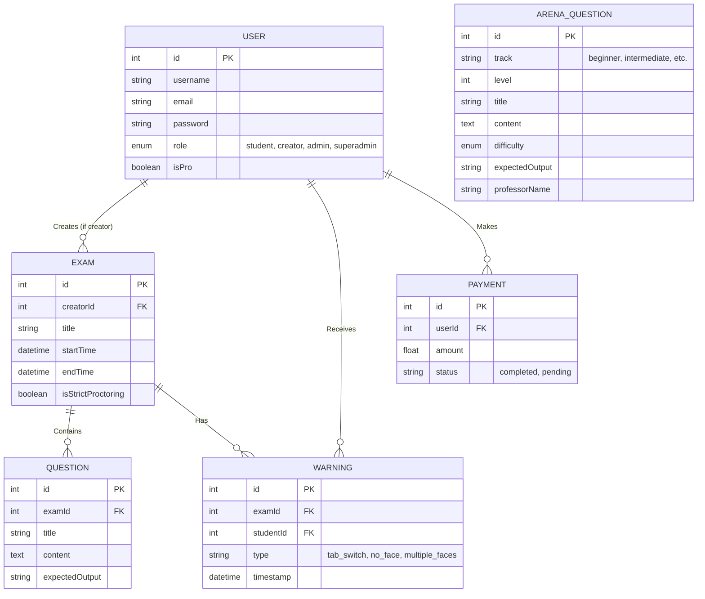
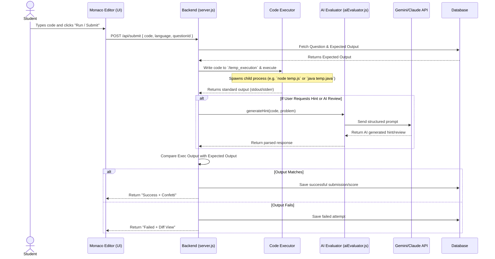

# 🏗️ QodeQuant Detailed Architecture

This document provides an in-depth look at the architecture of the QodeQuant platform. It includes system-level diagrams, database relationships, and key workflows.

---

## 1. System Context Diagram

QodeQuant is a modern Client-Server application. The frontend handles presentation and real-time monitoring via WebSockets, while the backend orchestrates code execution, database management, and AI evaluations.

```mermaid
graph TD
    %% Entities
    Student[🧑‍🎓 Student]
    Creator[👨‍🏫 Creator/Professor]
    Admin[🛡️ Admin]
    
    %% Frontend
    subgraph Frontend [React SPA (Vite)]
        UI[User Interface]
        CodeEditor[Monaco Editor]
        Proctor[MediaPipe Vision Proctoring]
    end

    %% Backend
    subgraph Backend [Node.js + Express API]
        Router[API Router]
        Socket[Socket.IO Server]
        Executor[Code Execution Engine]
        AIEngine[AI Evaluator Module]
        AuthMid[Auth & JWT Middleware]
    end

    %% External Systems
    DB[(SQL Database<br/>Sequelize ORM)]
    LLM[External LLMs<br/>Gemini / Claude]
    GoogleAuth[Google OAuth API]
    Email[SMTP/IMAP Server]

    %% Connections
    Student -->|Takes Exam| CodeEditor
    Student -->|Camera Feed| Proctor
    Creator -->|Creates Questions| UI
    Admin -->|Monitors Live| UI

    UI <-->|REST API (HTTPS)| Router
    UI <-->|Live Warnings (WSS)| Socket
    Proctor -->|Emits Violations| Socket
    CodeEditor -->|Submits Code| Router
    
    Router <--> AuthMid
    Router <--> Executor
    Router <--> AIEngine
    
    Executor -->|Saves Temp Files| LocalDisk[(Temp/Scratch Space)]
    AIEngine <-->|Sends Prompts| LLM
    Router <-->|Reads/Writes| DB
    AuthMid <-->|Verifies Token| GoogleAuth
    Router -->|Sends OTPs/Results| Email
```

---

## 2. Database Entity Relationship Diagram (ERD)

The database is managed via **Sequelize ORM**. Here is the relational structure of the core models:



---

## 3. Frontend Component & Routing Architecture

The React frontend utilizes `react-router-dom` to map URLs to specific dashboard components, segregating views by role and functionality.

```mermaid
graph TD
    App[App.jsx<br/>Router Provider]
    App --> Landing[/ /<br/>LandingPage.jsx]
    App --> Dash[/ /dashboard<br/>Dashboard.jsx]
    App --> Profile[/ /profile<br/>Profile.jsx]
    
    App --> RoleBased[Role-Based Routes]
    RoleBased --> Create[/ /create<br/>CreatorDashboard.jsx]
    RoleBased --> Admin[/ /admin<br/>AdminPanel.jsx]
    RoleBased --> Super[/ /superadmin<br/>SuperAdminPanel.jsx]
    
    App --> ExamEngines[Exam & Monitoring Routes]
    ExamEngines --> StdDash[/ /exam/:examId<br/>StudentDashboard.jsx]
    ExamEngines --> Arena[/ /arena/:track/:level<br/>ArenaExam.jsx via StudentDash]
    ExamEngines --> Monitor[/ /monitor/:examId<br/>MonitoringDashboard.jsx]
```

---

## 4. Key Sequence: Code Execution & AI Evaluation Flow

This sequence diagram illustrates what happens when a student submits their code during an exam.



---

## 🛠️ Tech Stack Summary

| Layer | Technologies Used |
|-------|------------------|
| **Frontend Framework** | React 19, Vite, Tailwind CSS 4, Lucide React |
| **Routing & Auth** | React Router 7, `@react-oauth/google` |
| **Code Editor** | `@monaco-editor/react` |
| **Client-Side AI/Vision** | `@mediapipe/tasks-vision` |
| **Backend API** | Node.js, Express 5.x |
| **Real-time Comms** | Socket.IO v4.x |
| **Database & ORM** | Sequelize v6.x (MySQL/SQLite) |
| **Server-Side AI** | `@google/generative-ai`, `@anthropic-ai/sdk` |
| **Security & Email** | `bcryptjs`, `jsonwebtoken`, `nodemailer` |
